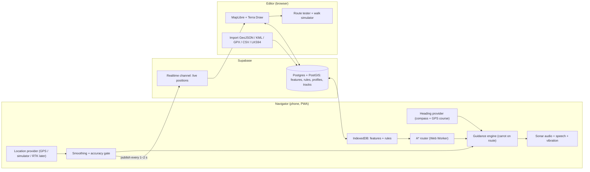

# Alouna – Rebuild Plan (handoff for Codex)

**Goal:** Help a blind person walk safely around a lakeside property (≈ 55.636 N, 25.695 E, Lithuania). The system has two parts:

1. **Editor (sighted admin):** a visual map where you draw, import, and edit areas, lines, and points; set rules; test routes; and watch users' live positions.
2. **Navigator (blind user):** guidance by GPS and compass, using **sonar-style spatial audio**. It plans routes around obstacles and follows rules (avoid ditches, cross the road only at crossings, and so on).

> [!CAUTION]
> Phone GPS is accurate to only about **3–10 m**, and worse under trees or near buildings. The app is an *aid* alongside a cane or a companion. It does not replace them. Use generous safety buffers around water and ditches. Test every route with a sighted companion first. To get precise accuracy later, see Phase 8 (RTK GNSS).

---

## 1. Tech stack

| Layer | Choice | Why |
|---|---|---|
| Language | **TypeScript** everywhere | One language. Codex handles it well. |
| Monorepo | **pnpm workspaces** | `apps/web` + `packages/core` |
| Frontend | **React 18 + Vite + React Router** | One app with two routes: `/editor` and `/navigate` |
| Map | **MapLibre GL JS** (via `react-map-gl/maplibre`) | Free, fast vector/raster maps, no API key |
| Drawing/editing | **Terra Draw** (`terra-draw` + MapLibre adapter) | Point, line, and polygon drawing plus vertex editing |
| Basemap | **Lithuanian orthophoto ORT10LT** (geoportal.lt WMS/WMTS), with OSM and Esri World Imagery as fallbacks | Aerial imagery where you can see the property itself |
| Geometry | **Turf.js** + **proj4** (EPSG:3346 LKS94 ↔ WGS84) | Buffers, distances, and LKS94 import (the old repo used LKS94) |
| Routing | **Custom grid A\*** in `packages/core`, run in a **Web Worker** | Applies the rules with costs (details in §4) |
| Audio | **Web Audio API** (oscillators + `StereoPannerNode`) + **SpeechSynthesis** | Sonar pings, left/right panning, spoken prompts |
| Backend | **Supabase** (Postgres + **PostGIS**, Auth, **Realtime**) | Stores features, rules, and users; streams live locations; free tier is enough |
| Offline | **vite-plugin-pwa** (Workbox) + **IndexedDB** (`idb-keyval`) | Lakeside mobile signal can be weak. Navigation must work offline. |
| Tests | **Vitest** (core logic), **Playwright** (smoke) | Routing and guidance math must be unit-tested |
| Hosting | **Cloudflare Pages / Netlify / Vercel** (HTTPS required for GPS and compass) | Free, auto-deploys from GitHub |
| Native shell (**M5b**, iPhone is the primary device) | **Capacitor 6** wrapper for iOS (Android later from the same code) | Haptics on iPhone, audio and GPS keep working with the screen locked or in a pocket, more reliable compass, Bluetooth RTK receiver later |

---

## 2. Architecture



`packages/core` holds **pure, framework-free TS** for geometry, rules, routing, and guidance. The editor and the navigator both use it, so a route tested in the editor is exactly the route the phone computes.

---

## 3. Data model (Supabase / PostGIS)

```sql
-- categories + their routing rules (editable in the Editor "Rules" panel)
create table category_rules (
  category      text primary key,      -- e.g. 'ditch'
  label         text not null,         -- 'Ditch'
  passable      boolean not null,      -- false = hard obstacle
  cost          real not null default 1, -- multiplier when passable (path 0.5, grass 1, rough 3)
  buffer_m      real not null default 0, -- inflate obstacle by this many meters
  warn_m        real default null,     -- speak a warning when closer than this
  overrides     text[] default '{}',   -- e.g. crossing overrides {'road'}, gate overrides {'fence'}
  priority      int not null default 0,-- higher wins when cells overlap
  color         text not null default '#888'
);

create table features (
  id            uuid primary key default gen_random_uuid(),
  name          text,
  category      text references category_rules(category),
  geom          geometry(Geometry, 4326) not null, -- Point / LineString / Polygon
  width_m       real,          -- for lines (road width, path width, fence thickness)
  radius_m      real,          -- for point obstacles (tree, post, rock)
  is_destination boolean default false, -- shows in the navigator destination list
  spoken_name   text,          -- what TTS says ("Sauna", "Jetty")
  notes         text,
  source        text check (source in ('drawn','gps','import')),
  enabled       boolean default true,  -- switch areas/objects off without deleting (e.g. neighbour plots)
  owner_label   text,          -- 'Ours', 'Neringa', 'Neighbour' – for walkable_area
  reviewed      boolean default false, -- features added by walkers need admin review
  gps_accuracy_m real,
  created_by    uuid references auth.users,
  created_at    timestamptz default now(),
  updated_at    timestamptz default now()
);

create table profiles (id uuid primary key references auth.users, display_name text, role text check (role in ('admin','walker')));
create table tracks (id bigserial primary key, user_id uuid, ts timestamptz, lon float8, lat float8, accuracy real, heading real); -- optional history
```

**Default categories (seed):**

| category | geom | passable | cost | buffer_m | warn_m | notes |
|---|---|---|---|---|---|---|
| `walkable_area` | polygon | – | – | – | – | Areas he may walk in (our plot, and later neighbours' plots, shore). **Multiple allowed.** Cells outside every walkable area are blocked. Each has `enabled` + `owner_label` so neighbour areas can be added or switched off. |
| `path` | line/polygon | ✅ | 0.4 | – | – | Preferred. Default `width_m` 1.5 |
| `grass` / default | – | ✅ | 1.0 | – | – | Cost of an unclassified cell inside a walkable area |
| `rough` | polygon | ✅ | 3.0 | – | – | Tall grass, roots, slope |
| `caution` | polygon | ✅ | 6.0 | – | 3 | Speaks when entering |
| `road` | line/polygon | ❌ | – | 1.0 | 5 | Blocked **except** where a `crossing` overrides |
| `crossing` | line/polygon | ✅ | 1.0 | – | 5 | `overrides {road}`. Says "Road crossing. Stop and listen." |
| `ditch` | line/polygon | ❌ | – | 1.5 | 4 | |
| `water` | polygon | ❌ | – | 2.5 | 6 | Lake |
| `dock` | line/polygon | ✅ | 1.0 | – | 3 | `overrides {water}` |
| `building` | polygon | ❌ | – | 0.5 | 2 | |
| `fence` / `wall` | line | ❌ | – | 0.3 | 2 | |
| `gate` / `door` | point/line | ✅ | 1.0 | – | 3 | `overrides {fence, wall, building}` |
| `obstacle` | point | ❌ | – | `radius_m` (default 0.7) | 2 | Tree, post, rock, bench |
| `steps` | point/line | ✅ | 2.0 | – | 3 | Says "Steps" |
| `no_go` | polygon | ❌ | – | 1.0 | 4 | |
| `landmark` | point | ✅ | – | – | – | Usually `is_destination = true` |

**Seed data:** convert the existing `wgs84coord.geojson` from the old repo ("Musu" → `walkable_area` enabled; neighbours "Neringos", "Kaimyno" → `walkable_area` **disabled**, ready to switch on; "Ežeras" → `water`; map-bound lines → ignored or `notes`). Translate names to English where it helps (e.g., "Ežeras" → "Lake").

---

## 4. Routing algorithm (`packages/core/routing`)

1. **Project** all features to **LKS94 (EPSG:3346)** in meters (proj4).
2. **Rasterize** to a grid over the bbox of all *enabled* `walkable_area`s plus a 20 m margin. Cell size **0.5 m** (configurable). A 300 × 300 m area gives 360k cells, which is fine in a worker.
   - **Built to grow (neighbours, shore):** the grid is split into **64 × 64 m tiles**, which are rasterized lazily and cached per tile and data version. A\* only loads the tiles it reaches. When the total area gets large (over about 1 km²), cell size is raised to 1.0 m automatically. Don't hard-code any bbox or property ID anywhere.
   - Initialize each cell: inside any enabled `walkable_area` → default cost 1.0. Outside → blocked.
   - Paint features in ascending `priority`. Lines are buffered by `width_m/2`, points by `radius_m`.
   - Blocked categories are inflated by `buffer_m` (safety margin).
   - **Overrides are painted last:** cells covered by a `crossing` become passable even where `road` blocked them, and the same for `gate` over `fence` and `dock` over `water`. This is how "cross the road only at a crossing" works: the road is a wall everywhere else.
3. **A\*** with 8-connectivity, octile heuristic, and cost = distance × cell cost. Add a small **clearance penalty**: a cell's cost goes up near blocked cells (distance transform), so routes stay in the middle of paths and away from hazards.
4. **Smooth** with line-of-sight string pulling. A segment may skip cells only if every cell along it is passable *and* has a cost no higher than its endpoints. This keeps the route on paths and inside crossings.
5. **Output** a polyline of waypoints in WGS84, plus annotated **events**: "enter crossing at waypoint 4", "steps at 32 m", "turn left 70°".
6. Cache the grid per data version (hash of features + rules) in IndexedDB. Rebuild only when the data changes.
7. **Snap start/end:** if the user's GPS position falls in a blocked cell (GPS noise), snap to the nearest passable cell and say so.

Unit tests (Vitest), each with a tiny synthetic map:
- A route around a single obstacle.
- A route that must use a distant crossing rather than cross the road directly.
- A route that must use a gate in a fence.
- "No route" when the target is enclosed.
- Path preference over grass when the path detour is under ~1.5×.

---

## 5. Navigator UX (blind user)

**Principles:** fully usable with **VoiceOver/TalkBack**. Huge buttons with good `aria-label`s, high contrast, very few screens. Everything is announced by speech. The phone is held flat, top edge pointing forward. Recommend **bone-conduction headphones** (e.g., Shokz) so he still hears cars, water, and people.

**Screens:**
1. **Home:** "Where to?" Destinations are a large list sorted by distance, plus a "Repeat last" button.
2. **Navigating:** one full-screen **Stop** button. Tap anywhere for "Where am I?" (spoken: nearest landmark, distance remaining, GPS quality). Swipe or double-tap for "Repeat instruction".
3. **Add here:** a big button (see §7). It can be hidden behind a setting if he shouldn't use it.

**Sonar audio design** (an upgrade of the attached example):

| Signal | Meaning |
|---|---|
| **Ping repetition rate** | Distance to the next waypoint: far = 1 ping / 1.5 s, close = 1 ping / 0.3 s |
| **Stereo pan** (`StereoPannerNode`) | **Which way to turn.** Target to the right → ping in the right ear. *The original example only told "how wrong", not "which way".* |
| **Pitch / brightness** | Alignment: on course (±10°) = high, bright ping with a short "tick-tick" confirmation. Off course = lower, duller ping. |
| **Low "whoop"** | Target is behind (>135°): turn around |
| **Rough buzz + vibration** | Hazard within `warn_m` (ditch/water/road), plus speech: "Ditch, 3 meters, left" |
| **Chime + speech** | Arrived (within 2 m, or within the GPS accuracy radius if that is larger, with a cap) |
| **Speech** | Start ("To the sauna, 85 meters"), turns >45° ("Turn left"), crossings ("Road crossing. Stop and listen."), steps, off-route, weak GPS |

- **Language:** **English only** (`en-US`/`en-GB` voice, chosen in settings, with speech rate adjustable). Keep all strings in one `strings.ts` so other languages could be added later, but don't build i18n infrastructure now.
- **Guidance logic** ("pure pursuit"): aim at a **carrot point** 4–6 m ahead along the route, not at the raw waypoint, so turns are smooth. Advance along the route by projecting the position onto the polyline.
- **Off-route:** if more than `max(4 m, accuracy)` from the route for more than 3 s → say "Recalculating" and re-plan from the current position.
- **Stop conditions:** if GPS accuracy is worse than 15 m, or there has been no fix for 5 s → pause the sonar and say "GPS weak, stop and wait".

**Heading (important fixes over the example):**
- iOS: `event.webkitCompassHeading`. Requires `DeviceOrientationEvent.requestPermission()` on a user tap.
- Android Chrome: use the **`deviceorientationabsolute`** event. Plain `deviceorientation` + `360 - alpha` is **not** relative to true north on Android. That is a bug in the example.
- Compensate for `screen.orientation.angle`. Lock the UI to portrait.
- Smooth with a circular low-pass filter (average the sin and cos of the angle, not the raw degrees).
- When walking faster than about 0.7 m/s with good accuracy, blend in the GPS `coords.heading` (course over ground).
- Apply magnetic declination (about +8° in Lithuania; make it configurable) if the platform gives magnetic rather than true north.

**Platform: iPhone is the primary device.** Plain web apps on iPhone have hard limits:
- No vibration (`navigator.vibrate` doesn't exist).
- Audio and GPS stop when the screen locks or the app goes to the background.
- The silent switch can mute Web Audio.
- Compass permission has to be requested on every launch.

So:
- **M5 (web version):** use the Screen **Wake Lock API** (iOS 16.4+) to keep the screen on. Resume the `AudioContext` on every user tap. Play a silent `<audio>` element in a loop so the silent switch doesn't mute the sonar. This is good enough for testing.
- **M5b (Capacitor iOS app):** the version he uses day to day. It brings in:
  - Haptics (`@capacitor/haptics`: Taptic Engine pulses for on course, turns and hazards).
  - Background location (`@capacitor-community/background-geolocation`).
  - The `audio` background mode in `Info.plist`, so the sonar keeps playing with the screen locked.
  - The native compass (`CLLocationManager` true heading, via a small plugin or `@capacitor/motion` if it's accurate enough).
  - An `AVAudioSession` `.playback` category, so the silent switch doesn't mute it.
- The sensors and haptics live behind interfaces (`locationProvider`, `headingProvider`, `haptics`). The same React code then runs both in Safari and in the iOS app.
- Distribution: install it with Xcode on your Mac. A free Apple ID means re-installing every 7 days. The paid Apple Developer account (€99/yr) gives **TestFlight**, which keeps it on his phone without re-installing.

---

## 6. Editor UX (sighted admin)

- **Map:** orthophoto basemap with a layer switcher. Features are styled by category color. A category legend toggles layer visibility.
- **Draw/edit:** Terra Draw modes for point, line, polygon, circle (obstacle with radius), select, vertex edit, and delete. A side panel edits name, category, width or radius, destination flag, spoken name, and notes.
- **Rules panel:** edit the `category_rules` table (passable, cost, buffer, warn distance, overrides, color).
- **Route tester:** click a start and an end, or pick destinations. The editor shows:
  - the route polyline with distance and events
  - an optional **cost-grid debug overlay** (heatmap of blocked and costed cells, including buffers)
  - "Why no route?" highlighting.
- **Walk simulator:** a virtual walker moves along the route (or you drive it with arrow keys plus a heading control). It plays the **real sonar audio** in the browser, so you can tune the sounds at home.
- **Live users:** dots with a heading arrow, accuracy circle, name, and current route and destination, from Supabase Realtime. Also last-seen time, battery (if available), and an optional track trail.
- **Import:** drag and drop **GeoJSON, KML, GPX, CSV** (`lat,lon` / `lon,lat` / `x,y`), or paste coordinates as text. A CRS selector offers **WGS84** or **LKS94 (EPSG:3346)** and auto-detects plausible ranges. Preview before saving. Assign a category to the imported batch.
- **Export:** GeoJSON backup of all features and rules.
- **Undo/redo** and a simple **version history** (`updated_at` + soft delete).

---

## 7. Adding objects from the field ("Add here")

On the phone, available in the navigator settings and in the editor on mobile:
- **Point:** "Add here" → **averages GPS fixes for 10–20 s** and discards fixes with accuracy worse than 10 m. It shows and speaks the resulting accuracy. Then you pick a category and a name. Voice input for the name is optional, via the keyboard dictation button.
- **Line / area by walking:** "Start recording" → walk along the ditch edge, fence, or path → "Stop". The app simplifies the track (Turf `simplify`, about 0.5 m tolerance) and saves it as a line, or as a closed polygon.
- **Offset capture:** "Object is ~2 m in front of me" uses the compass heading plus a distance to place a point you can't stand on (water edge, ditch).
- Everything saves offline first and syncs when back online (queue in IndexedDB).
- Field-captured features are marked `source='gps'` with `gps_accuracy_m`, so you can review and adjust them on the orthophoto in the editor.

---

## 8. Live location

- The navigator publishes `{user_id, lon, lat, accuracy, heading, speed, destination_id, route_progress, ts}` every **1–2 s** on the Supabase Realtime **broadcast** channel `live-positions`. **Presence** tracks who is online.
- Optionally insert one row every 10 s into `tracks` for history and debugging (with a retention setting).
- The editor subscribes to the channel and renders the markers.
- Auth: Supabase email magic link. Roles: `admin` (editor plus everything, including rules and deleting anyone's features) and `walker` (navigator; **can read and add features**, and edit or delete only their own). Use RLS policies accordingly. In the editor, admins see features added by walkers highlighted as *needs review* (`reviewed boolean default false`).

---

## 9. Repo layout

Start fresh. Delete the old files and keep only `wgs84coord.geojson` as seed data.

```
alouna/
├─ AGENTS.md                 # instructions for Codex (conventions, commands)
├─ docs/PLAN.md              # this file
├─ package.json / pnpm-workspace.yaml
├─ packages/core/src/
│   ├─ geo/        (projection.ts, distance.ts, bearing.ts, polyline.ts)
│   ├─ rules/      (defaults.ts, types.ts)
│   ├─ routing/    (rasterize.ts, astar.ts, smooth.ts, events.ts, router.worker.ts)
│   ├─ guidance/   (carrot.ts, offRoute.ts, hazards.ts, guidanceEngine.ts)
│   └─ import/     (geojson.ts, kml.ts, gpx.ts, csv.ts, crsDetect.ts)
├─ apps/web/src/
│   ├─ editor/     (MapView, DrawTools, FeaturePanel, RulesPanel, RouteTester, Simulator, LiveUsers, ImportDialog)
│   ├─ navigator/  (Home, Navigating, AddHere, RecordWalk, Settings)
│   ├─ audio/      (sonar.ts, speech.ts, cues.ts)
│   ├─ sensors/    (locationProvider.ts [gps|sim], headingProvider.ts, wakeLock.ts)
│   ├─ data/       (supabase.ts, featureStore.ts [IndexedDB + sync], realtime.ts)
│   └─ strings.ts  (all user-facing/spoken English text)
└─ supabase/
    ├─ migrations/  (0001_init.sql with PostGIS, tables, RLS)
    └─ seed/        (seed.sql generated from wgs84coord.geojson)
```

---

## 10. Milestones (give Codex one at a time)

| # | Milestone | Done when |
|---|---|---|
| **M0** | Scaffold: pnpm monorepo, Vite React TS, Vitest, ESLint/Prettier, AGENTS.md, CI (GitHub Actions: lint + test + build), deploy to Pages | The empty app is live on HTTPS |
| **M1** | `packages/core`: projection, geo math, rules types and defaults, rasterize, A\*, smoothing, route events. Full unit tests from §4. | `pnpm test` is green. The road/crossing test passes. |
| **M2** | Supabase: migration, RLS, seed from old GeoJSON. Data layer with an IndexedDB cache and offline queue. | Features load in the app offline after the first visit |
| **M3** | Editor: map + orthophoto, Terra Draw editing, feature panel, rules panel, import (GeoJSON/KML/GPX/CSV/LKS94), export | You can draw and import the property, toggle neighbour areas on and off, and edits persist |
| **M4** | Editor route tester + cost-grid overlay + walk simulator (with audio from M5 once it exists) | Click A → B and see the correct rule-following route |
| **M5** | Navigator: destinations, heading provider (iOS/Android fixes), location provider (GPS + simulator), guidance engine, sonar audio, speech (lt/en), hazard warnings, off-route re-plan, wake lock | Simulated walk works in the browser. A real phone walk works outdoors. |
| **M5b** | **Capacitor iOS shell**: haptics, background location, background audio, native true heading, silent-switch-proof audio session, `Info.plist` permission texts; TestFlight build | Navigation keeps working with the iPhone locked in his pocket or hand, with haptic cues |
| **M6** | Live location: realtime publish/subscribe, presence, optional tracks | The editor shows the phone moving live |
| **M7** | Field capture: Add here (averaged), record walk (line/polygon), offset capture, offline sync | You can map a ditch by walking along it |
| **M8** | PWA polish + field testing: installable, offline, accessibility audit with VoiceOver, tune buffers and sounds on site | Brother completes test routes with a companion shadowing him |
| **M9** *(optional)* | **Bluetooth RTK GNSS** plugin for the Capacitor app (e.g., ArduSimple/u-blox ZED-F9P or Emlid Reach RX with **LitPOS** NTRIP corrections → ~2 cm accuracy) | Accuracy goes from meters to centimeters |

> [!TIP]
> If the brother will use it a lot near the water or ditches, M9 with an RTK receiver (about €250–500) is the single biggest safety upgrade. The `locationProvider` abstraction in M5 means nothing else needs to change.

---

## 11. Prompt to give Codex (per milestone)

```
You are implementing the Alouna project. Read docs/PLAN.md fully first; it is the
source of truth. Implement milestone M<N> only. Keep packages/core framework-free and
fully unit-tested. Use TypeScript strict mode. Do not invent new dependencies beyond
the stack in §1 without explaining why. Update AGENTS.md with any commands/conventions
you add. When done: run lint, tests and build, and summarize what was done, what is
left, and any deviations from the plan.
```

---

## 12. Decisions made

1. **Device:** mostly iPhone. iOS comes first, with the native shell in M5b. Android stays supported through the same code.
2. **Language:** English only.
3. **Who adds objects:** both the admin and the walker. Walker additions are flagged *needs review* in the editor.
4. **Area:** start with our plot. The design must allow adding neighbours' plots and the shore later (multiple `walkable_area`s, tiled routing grid, nothing hard-coded).
